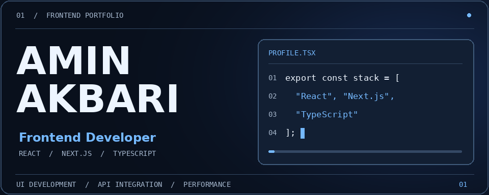
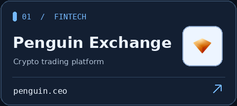
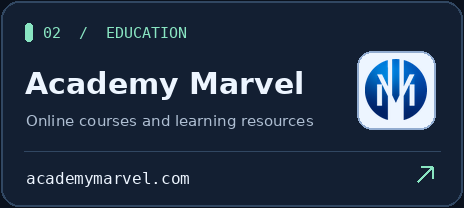
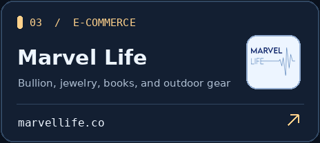
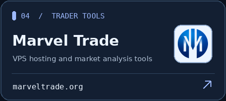
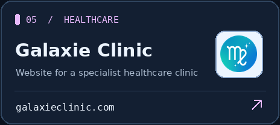
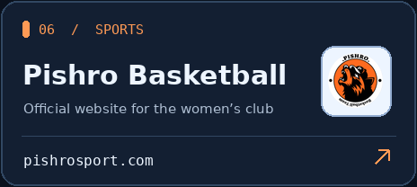
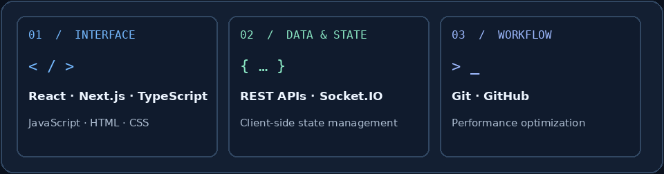
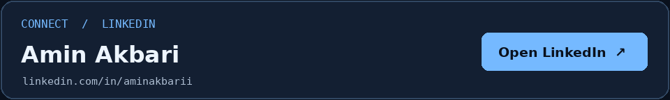

# Amin Akbari

I build responsive web interfaces, integrate APIs, and manage client-side state for products across finance, education, commerce, and healthcare.

[Projects](#projects) · [Technical stack](#technical-stack) · [Contact](#contact)

## Projects

  
  

  
  

  
  

*Penguin Exchange, Academy Marvel, Marvel Life, and Marvel Trade are part of Marvel Frequency.*

[Projects on LinkedIn ↗](https://ir.linkedin.com/in/aminakbarii)

## Technical stack

## Contact

